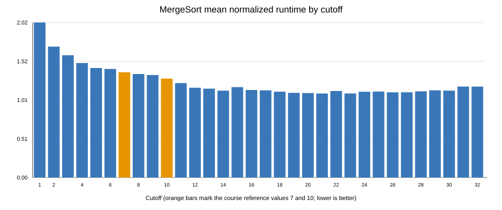
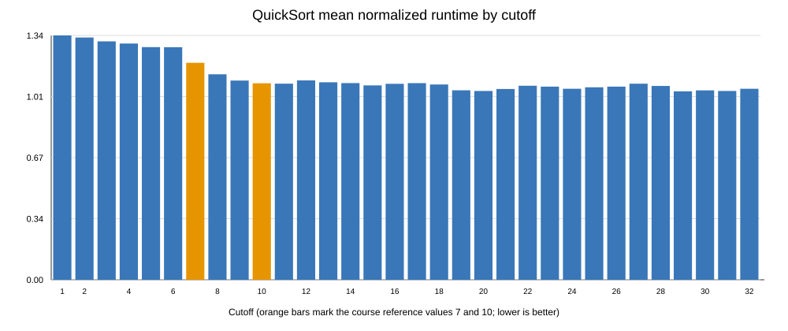

# MergeSort and QuickSort cutoff experiment

## Goal

Compare the lecture-style MergeSort and QuickSort implementations while they switch to InsertionSort for small partitions. The sweep includes the course reference cutoffs 7 and 10 and searches every integer cutoff from 1 through 32.

## Method

- Algorithms: MergeSort and QuickSort, using the implementations in `src/sorting`.
- Input sizes: 1000, 10000, 50000 integers.
- Distributions: random, sorted, reverse, nearly_sorted, few_unique. The nearly sorted case starts sorted and applies about 1% random swaps; few_unique uses 16 possible values.
- Each configuration uses 2 warmup runs and 7 measured runs. The reported value is the median elapsed time in nanoseconds. Input copying and correctness checks are outside the timed section.
- Data seed: base seed 20261126 plus input size for benchmark arrays; sample CSV files use the base seed. QuickSort also shuffles internally using its current implementation.

## Summary

The overall score is the mean of each configuration runtime divided by the fastest runtime for that same algorithm, input size, and distribution. Lower is better; this gives each workload equal weight. A best cutoff at either sweep endpoint (1 or 32) means the search range should be expanded before treating it as optimal.

| Algorithm | Best aggregate cutoff | Mean normalized runtime |
|---|---:|---:|
| MergeSort | 21 | 1.0950 |
| QuickSort | 29 | 1.0348 |

The best cutoff can vary with CPU, JVM, and workload. Treat these values as results from the machine that ran this experiment, not as universal constants. Review `results.csv` before drawing conclusions.

## Course cutoff comparison

| Algorithm | Cutoff | Mean normalized runtime |
|---|---:|---:|
| MergeSort | 7 | 1.3728 |
| MergeSort | 10 | 1.2896 |
| QuickSort | 7 | 1.1915 |
| QuickSort | 10 | 1.0791 |

Lower normalized runtime is better. Cutoffs 7 and 10 are also highlighted in orange in the charts.

## Charts

## Detailed best cutoff by workload

| Algorithm | Distribution | Size | Best cutoff | Median time (ns) |
|---|---|---:|---:|---:|
| MergeSort | random | 1000 | 23 | 20500 |
| QuickSort | random | 1000 | 20 | 37300 |
| MergeSort | random | 10000 | 27 | 474100 |
| QuickSort | random | 10000 | 15 | 507500 |
| MergeSort | random | 50000 | 13 | 2697900 |
| QuickSort | random | 50000 | 30 | 2936700 |
| MergeSort | sorted | 1000 | 32 | 5900 |
| QuickSort | sorted | 1000 | 18 | 37300 |
| MergeSort | sorted | 10000 | 21 | 82800 |
| QuickSort | sorted | 10000 | 29 | 489700 |
| MergeSort | sorted | 50000 | 26 | 478600 |
| QuickSort | sorted | 50000 | 23 | 2872500 |
| MergeSort | reverse | 1000 | 24 | 9300 |
| QuickSort | reverse | 1000 | 31 | 38700 |
| MergeSort | reverse | 10000 | 14 | 106100 |
| QuickSort | reverse | 10000 | 31 | 491300 |
| MergeSort | reverse | 50000 | 15 | 630900 |
| QuickSort | reverse | 50000 | 18 | 2909600 |
| MergeSort | nearly_sorted | 1000 | 32 | 6400 |
| QuickSort | nearly_sorted | 1000 | 29 | 38200 |
| MergeSort | nearly_sorted | 10000 | 31 | 100700 |
| QuickSort | nearly_sorted | 10000 | 19 | 493500 |
| MergeSort | nearly_sorted | 50000 | 26 | 611400 |
| QuickSort | nearly_sorted | 50000 | 31 | 2922100 |
| MergeSort | few_unique | 1000 | 30 | 8400 |
| QuickSort | few_unique | 1000 | 27 | 27200 |
| MergeSort | few_unique | 10000 | 16 | 261500 |
| QuickSort | few_unique | 10000 | 32 | 277700 |
| MergeSort | few_unique | 50000 | 23 | 1484200 |
| QuickSort | few_unique | 50000 | 28 | 1491100 |

## Reproducibility

Run `java -cp out experiment.Main` from the project root after compiling the source files. This regenerates sample data, `results/results.csv`, this report, and both SVG charts.
